# Trifle 🍒

**One clue. Three hidden words. A new puzzle every day on Reddit.**

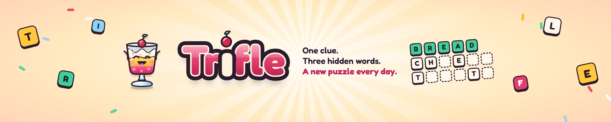

Trifle is a daily word association race built with Reddit's Devvit Web platform. This repository holds its media: screenshots, the community banner and icon, and custom emoji.

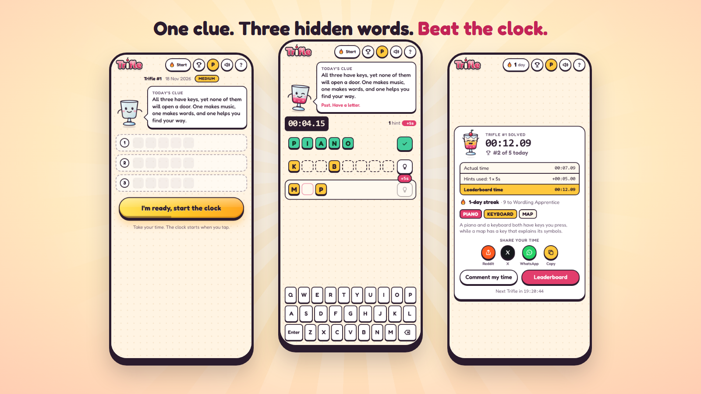

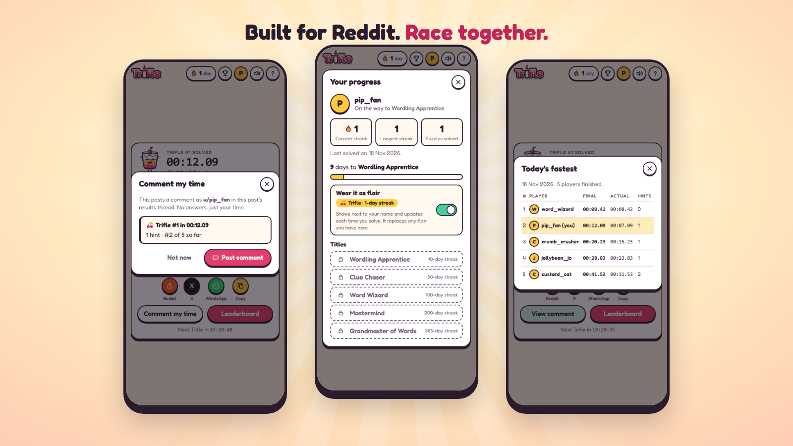

## Screenshots

| Launch | How to play | Clue |
|---|---|---|
| 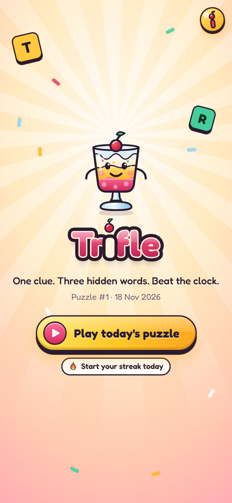 | 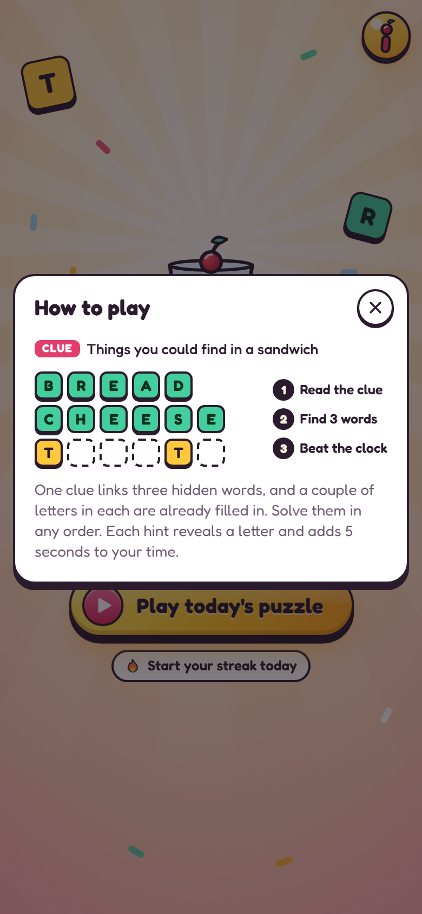 | 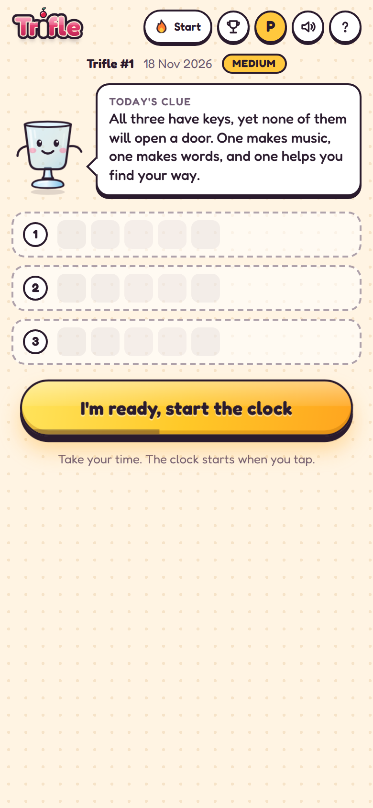 |

| Solving | Result | Comment my time |
|---|---|---|
| 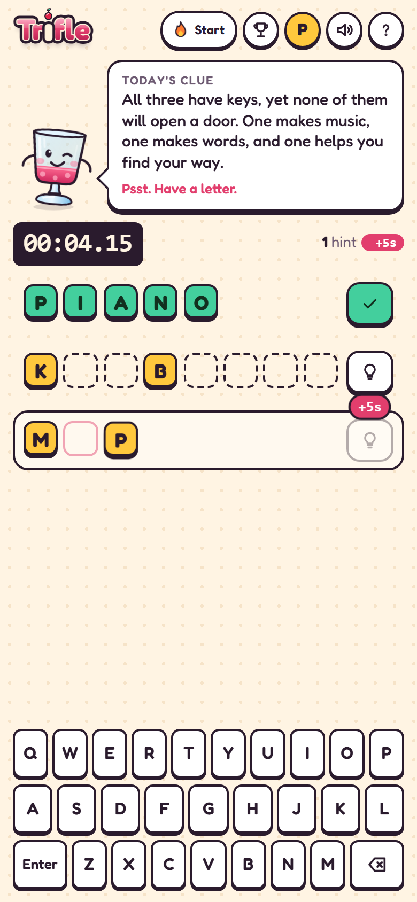 | 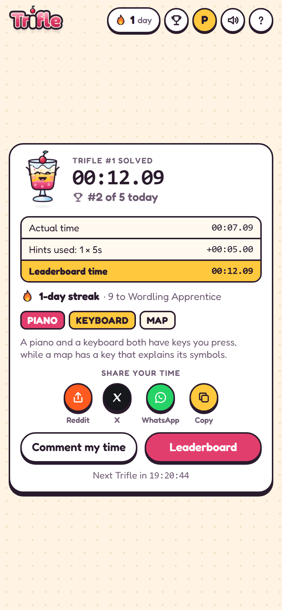 | 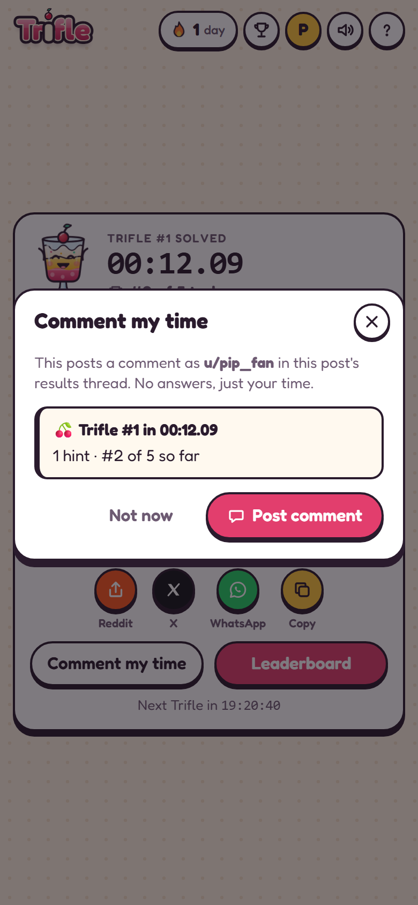 |

| Trifle flair | Leaderboard | Back in the feed |
|---|---|---|
| 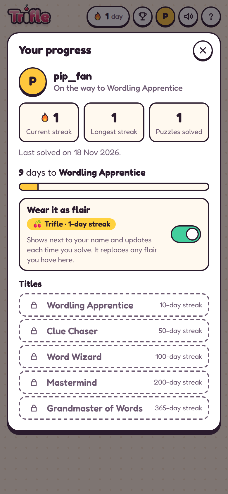 | 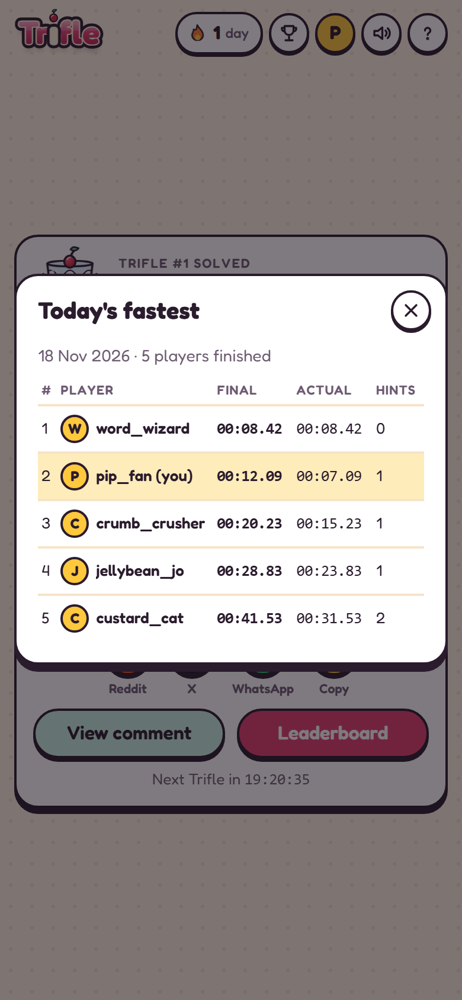 | 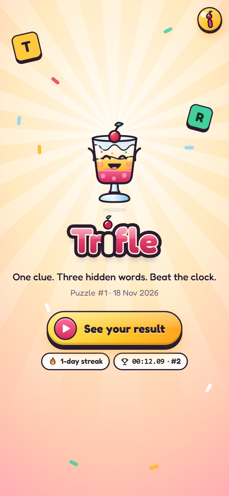 |

## Community assets

| Icon | Emoji |
|---|---|
| 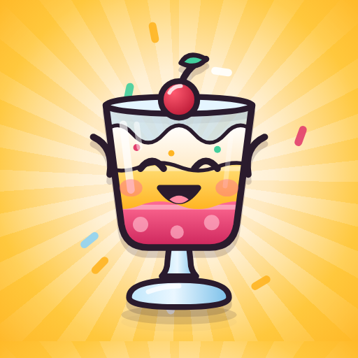 | 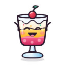 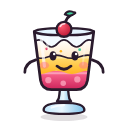 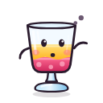 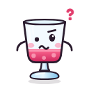 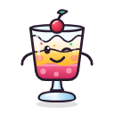 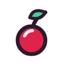 |

Player names in the screenshots are made up.
